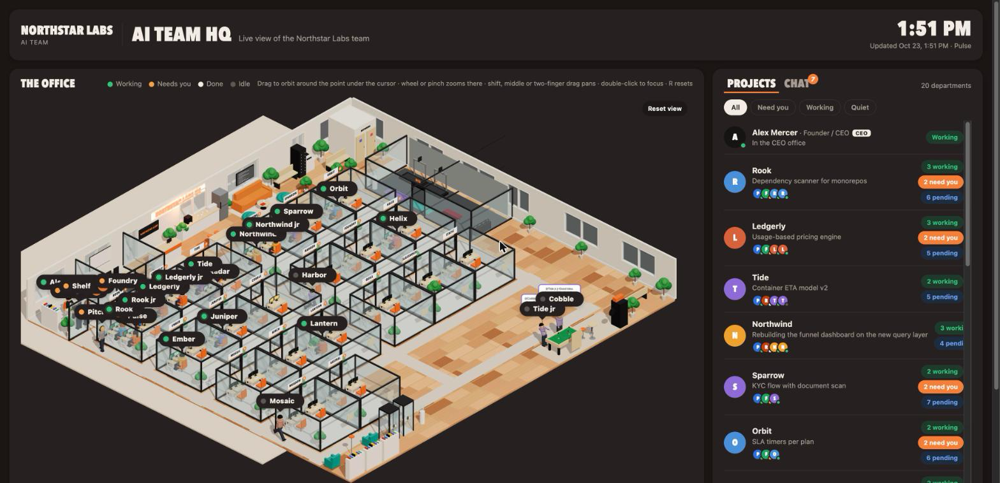
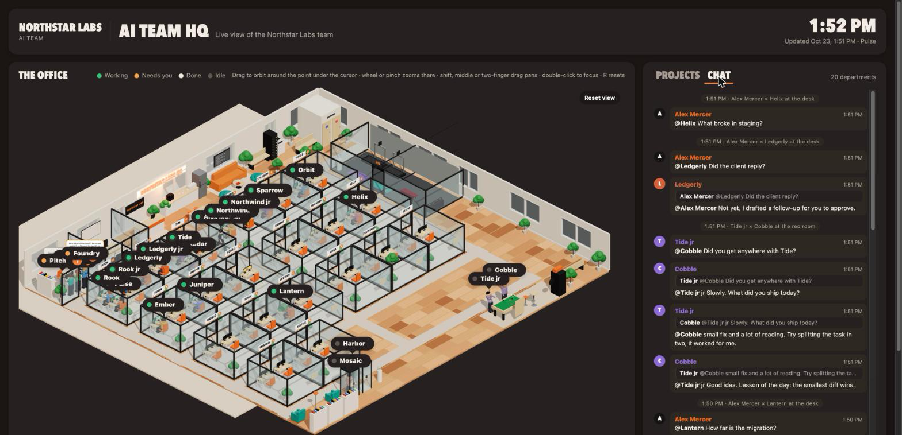

# borgyHQ

An animated 3D office for your AI team. Every Claude Code session you have open, every sub-agent it spawns and every scheduled agent you run shows up as an employee at a desk, in a glass room named after the project it works on. Projects come from an Obsidian-style vault of Markdown notes. Everything runs locally from one Python file and one HTML page.



Working people type at green screens. Someone waiting for your answer walks into the CEO office and holds up the question. Idle people get coffee, print, play pool, hit the gym, read in the library or chat in pairs. The CEO walks over to a developer when you send it a prompt, and the developer answers back. The CHAT tab keeps the thread.



## 60-second demo

```bash
git clone https://github.com/iamB0rgy/borgyHQ.git
cd borgyHQ
python3 server.py --demo
```

Open http://localhost:4747. The demo runs on a fictional company with 20 projects, 14 sessions, 4 sub-agents, 5 agents, 3 pending cards and canned office small talk. Nothing is read from your machine.

## Real setup

1. **team.json**: your name, title, company (the neon sign), the vault path, an optional `aliases` map (`"folder-name-in-cwd": "Vault Project"`) and the agents you run.
2. **Vault layout**: one folder per project under the vault. A folder counts as a project when it holds a `Status.md`, a hub page `<Project>/<Project>.md` or a `Decisions.md`. Folders named `raw`, `wiki`, `outputs`, `system`, `templates`, `inbox` are skipped.

   `<Project>/<Project>.md` (hub, optional):
   ```markdown
   ---
   tags: [shop, hub]
   pet: Cobble
   ---
   ```
   `pet` is the short name on the door sign. `<Project>/Status.md`:
   ```markdown
   ---
   last_synced: 2026-10-23 11:02
   ---
   ## In progress
   - Checkout redesign A/B test

   ## Pending
   - Gift cards
   - Back-in-stock notifications

   ## Recently done
   - 2026-10-22 Search autocomplete
   ```
   Top-level `- ` bullets only. Wikilinks and bold are stripped. The first In-progress bullet is the project's status line, the Pending count is the orange badge on the door.
3. **Run it**:
   ```bash
   python3 server.py --bridge
   ```
   `--bridge` starts `bridge.py` in a thread: every 20 s it reads `~/.claude/sessions/*.json` and the session transcripts under `~/.claude/projects/`, maps each session's working directory to a vault project (case and space insensitive folder-name match, then `aliases`), and writes `state/sessions.json`. You can also run `python3 bridge.py` on its own (`--once` for a single write, `--check` for the self-test). `python3 server.py --port 4800` changes the port.

See `samples/` for a complete worked example of team.json, vault, sessions and cards.

## Agents and cards

`agents/<id>/CLAUDE.md` describes a scheduled Claude Code agent (Pulse the project manager, Forge engineering, Radar ops, Shelf marketing, Pitch sales are the samples). `./install.sh` links `bin/hq` into `~/.local/bin` and wires Claude Code hooks into each agent folder so the dashboard shows Working, Waiting and Done without any AI involved.

- `cd agents/forge && claude` runs an agent interactively; `bin/run-agent forge` runs one headless shift; `bin/schedule forge 60` runs it hourly with launchd (macOS).
- Agents report with `hq task "…"` and ask with `hq card "title" "detail"`. A card is a decision for you: Approve, Hold or Reject with a note on the dashboard (the orange **Need you** tally). Agents never act before a card is approved.
- Add an agent: make the folder with a CLAUDE.md, add it to `team.json`, re-run `./install.sh`.

## Optional small talk

When two idle people meet, the server can ask a local [Ollama](https://ollama.com) model for four to six lines of small talk built from the project status. Set `ollama_model` in `team.json` (default `qwen3.5:9b`). When Ollama is not reachable the office stays quiet except for the built-in one-liners. The demo never calls Ollama unless you set `OLLAMA=1`.

## Controls

Drag to orbit, wheel or pinch to zoom at the cursor, shift, middle or two-finger drag to pan, double-click to focus, arrow keys rotate and tilt, `+`/`-` zoom, `R`, `0` or Home reset. Hover a person for their status and last line, a door sign for the status line and pending items; click either to filter the project list. PROJECTS lists every room with its people, pending bullets and cards; CHAT is the conversation thread. `dashboard/office.json` sets the CEO desk position.

## Privacy

Everything stays on your machine. The server binds to 127.0.0.1 only, reads the vault, `~/.claude/sessions` and transcripts read-only, and the only network call is the optional one to your local Ollama. Nothing is uploaded anywhere. `state/` (sessions, cards, chat log) is ignored by git.

## Requirements

Python 3.11 or newer, a modern browser with WebGL, macOS or Linux. No npm, no build step: three.js is vendored in `dashboard/vendor/`.

## License

MIT, see `LICENSE`. three.js is MIT, see `dashboard/vendor/LICENSE`.

## Credits

Made by [LouWard Labs](https://louward.com). MIT licensed.
